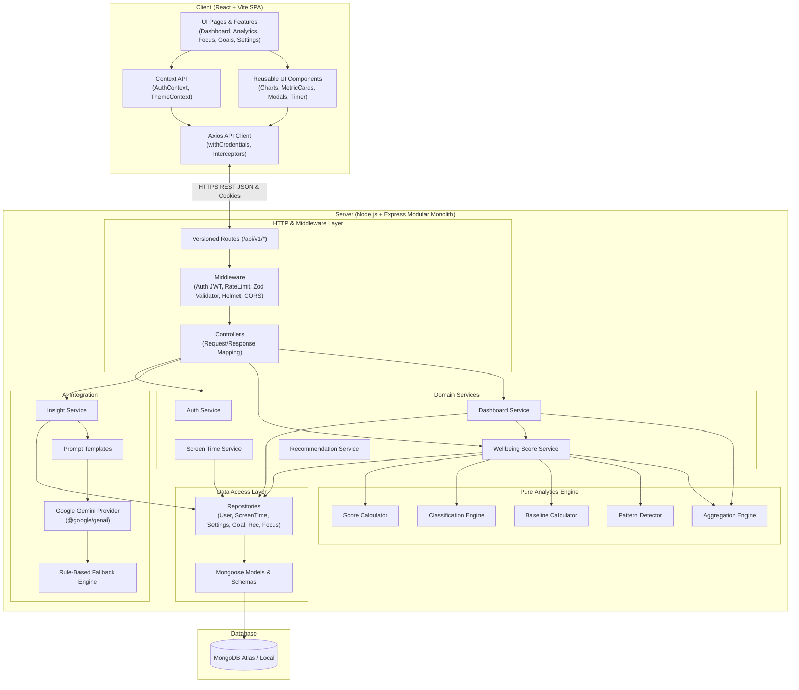

# Digital Wellbeing Analyzer — Architecture Documentation

## 1. System Overview

**Digital Wellbeing Analyzer** is a full-stack, production-minded modular web application designed to analyze personal screen-time data, detect problematic usage patterns (e.g., late-night binge sessions, high category concentration, goal overages), calculate an explainable Digital Wellbeing Score (0–100), and generate actionable behavioral insights through Google Gemini with a deterministic rule-based fallback.

The system is designed as a **Modular Monolith** adhering to strict layered separation of concerns:
- **Presentation Layer (Frontend)**: React 18+ Single Page Application with Vite, Tailwind CSS, Recharts, and React Router.
- **API & Controller Layer**: Express.js REST API with input validation (Zod), route controllers, rate limiting, and centralized error handling.
- **Domain Business Layer**: Isolated domain services (`screenTimeService`, `wellbeingScoreService`, `dashboardService`, `recommendationService`).
- **Analytics & Pure Computation Layer**: Independent pure JavaScript engines decoupled from Express and Mongoose (`aggregationEngine`, `patternDetector`, `baselineCalculator`, `classificationEngine`, `scoreCalculator`).
- **AI Integration Layer**: Isolated Gemini provider with structured JSON generation and instant deterministic fallback.
- **Data Access Layer**: Repositories abstracting Mongoose models and queries, guaranteeing authenticated user isolation on every query.
- **Persistence Layer**: MongoDB Atlas / local MongoDB with indexed Mongoose schemas.

---

## 2. High-Level Architectural Diagram



---

## 3. End-to-End Request Flows

### 3.1 Standard Screen-Time Mutation / Query
```
Client UI
  └── axios.post('/api/v1/screen-time', data)
      └── Express Route (/api/v1/screen-time)
          └── authenticate middleware (verifies HTTP-only JWT cookie)
          └── validateRequest(createScreenTimeSchema) (Zod validation)
          └── screenTimeController.createRecord(req, res, next)
              └── screenTimeService.createRecord(userId, validatedData)
                  └── screenTimeRepository.create({ ...validatedData, userId })
                      └── Mongoose ScreenTimeRecord.create()
                          └── MongoDB Document Persisted
                      └── Returns created record
              └── apiResponse.success(res, 201, record)
```

### 3.2 Analytics & Wellbeing Score Flow
```
Client UI (Analytics Page / Dashboard)
  └── axios.get('/api/v1/analytics/overview?startDate=...&endDate=...')
      └── Express Route (/api/v1/analytics/overview)
          └── authenticate middleware
          └── analyticsController.getOverview(req, res, next)
              └── dashboardService.getOverview(userId, dateRange)
                  ├── screenTimeRepository.findByUserAndDateRange(userId, range)
                  ├── settingsRepository.findByUserId(userId)
                  ├── aggregationEngine.calculateDailyAggregates(records)
                  ├── aggregationEngine.calculateCategoryBreakdown(records)
                  ├── aggregationEngine.calculateAppUsageBreakdown(records)
                  ├── baselineCalculator.computeWeekOverWeek(currentWindow, previousWindow)
                  ├── patternDetector.detectAnomalies(records, settings, baselines)
                  └── scoreCalculator.computeWellbeingScore(aggregates, patterns, settings)
              └── apiResponse.success(res, 200, analyticsData)
```

### 3.3 AI Insights Generation Flow
```
Client UI (AI Insights Page -> "Generate Fresh Insights")
  └── axios.post('/api/v1/insights/generate')
      └── Express Route (/api/v1/insights/generate)
          └── authenticate middleware + rateLimiter
          └── insightController.generate(req, res, next)
              └── insightService.generateUserInsights(userId)
                  ├── Fetches 14-day aggregated metrics & detected patterns via dashboardService
                  ├── Sanitizes data (no PII, no credentials, strictly validated numbers)
                  ├── Formulates structured prompt using promptTemplates
                  ├── Invokes geminiProvider.generateStructuredInsight(promptPayload)
                  │     ├── Calls Google GenAI API with JSON Schema
                  │     ├── Parses & validates response against Zod schema
                  │     └── If API error / quota limit / malformed JSON:
                  │           └── Automatically triggers fallbackEngine to build
                  │               evidence-backed deterministic recommendations!
                  ├── Persists generated recommendations to Recommendation collection
                  └── apiResponse.success(res, 200, { source: 'gemini' | 'rule_fallback', insights })
```

---

## 4. Key Architectural Guarantees & Security

1. **User Scoping & Isolation**:
   Every database query and mutation executed in repositories strictly binds `userId: req.user._id`. Private resources cannot be accessed or manipulated by simply substituting an ObjectId.
2. **Zero Leaked Secrets**:
   - `JWT_SECRET`, `MONGODB_URI`, and `GEMINI_API_KEY` reside exclusively in server `.env`.
   - Client `.env` contains only `VITE_API_BASE_URL`.
   - Sanitized error handler strips stack traces in non-development modes and never logs secrets.
3. **HTTP-only Cookies & CSRF Defense**:
   JWT authentication tokens are delivered via `httpOnly`, `sameSite: 'lax'` (or `'none'` for cross-site), `secure` cookies.
4. **Resilient AI Pipeline**:
   The application never crashes if the Gemini API key is missing or invalid. The deterministic rule-based engine provides immediate, high-quality, actionable advice matching the user's specific detected patterns.
5. **No Double-Counting in CSV Import**:
   Imports detect existing entries matching `(userId, applicationName, date, startTime)` or exact daily date aggregates, upserting or cleanly reporting accepted vs. skipped duplicates.

---

## 5. Deployment Topology

- **Frontend**: Hosted on **Vercel** or static CDN, configured with client-side routing fallback (`vercel.json` rewrites).
- **Backend**: Hosted on **Render** (Node.js Web Service) with health check probes on `/api/v1/health`.
- **Database**: **MongoDB Atlas** M0/M10 cluster with network access IP whitelist and SSL/TLS.
- **Future Native Companion Application**:
  Can easily feed the identical REST API (`POST /api/v1/screen-time/import` or `POST /api/v1/screen-time/batch`) via a background daemon on Android (using `UsageStatsManager`) or desktop (using Windows API `GetForegroundWindow`).
