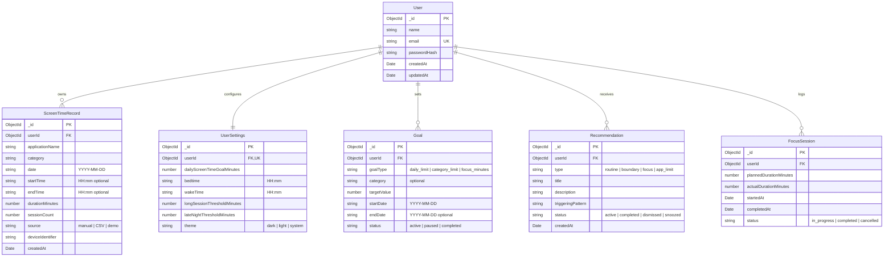

# Digital Wellbeing Analyzer — Data Model Specification

## 1. Entity Relationship Overview

---

## 2. Detailed Mongoose Schemas & Indexes

### 2.1 User (`users`)
- `name`: String, required, trimmed, min 2, max 50.
- `email`: String, required, unique, lowercase, trimmed, valid email format.
- `passwordHash`: String, required, excluded from default queries (`select: false`).
- **Indexes**:
  - `{ email: 1 }`, unique: true.

### 2.2 ScreenTimeRecord (`screentimerecords`)
- `userId`: ObjectId, ref: 'User', required, indexed.
- `applicationName`: String, required, trimmed.
- `category`: String, enum: `['Social', 'Entertainment', 'Productivity', 'Gaming', 'Communication', 'Utilities', 'Other']`, required.
- `date`: String, formatted as `YYYY-MM-DD` (e.g. `2026-10-10`) for consistent date math across time zones without UTC midnight skew.
- `startTime`: String, optional (`HH:mm`, 24h format).
- `endTime`: String, optional (`HH:mm`, 24h format).
- `durationMinutes`: Number, required, min: 1, max: 1440.
- `sessionCount`: Number, default: 1, min: 1.
- `source`: String, enum: `['manual', 'CSV', 'demo']`, default: 'manual'.
- `deviceIdentifier`: String, default: 'Primary Device'.
- **Compound Indexes**:
  - `{ userId: 1, date: -1 }` (optimizes date-range aggregations).
  - `{ userId: 1, date: 1, applicationName: 1, startTime: 1 }` (uniqueness check to prevent duplicate imports).
  - `{ userId: 1, category: 1 }` (optimizes category aggregations).

### 2.3 UserSettings (`usersettings`)
- `userId`: ObjectId, ref: 'User', required, unique.
- `dailyScreenTimeGoalMinutes`: Number, default: 360 (6 hours), min: 30, max: 1440.
- `bedtime`: String, default: '23:00' (11:00 PM).
- `wakeTime`: String, default: '07:00' (7:00 AM).
- `longSessionThresholdMinutes`: Number, default: 90 (1.5 hours).
- `lateNightThresholdMinutes`: Number, default: 45 (minutes active after bedtime).
- `theme`: String, enum: `['dark', 'light', 'system']`, default: 'dark'.

### 2.4 Goal (`goals`)
- `userId`: ObjectId, ref: 'User', required, indexed.
- `goalType`: String, enum: `['daily_limit', 'category_limit', 'focus_minutes']`, required.
- `category`: String, optional (required if `goalType` is `category_limit`).
- `targetValue`: Number, required, min: 1.
- `startDate`: String, format `YYYY-MM-DD`, required.
- `endDate`: String, format `YYYY-MM-DD`, optional.
- `status`: String, enum: `['active', 'paused', 'completed']`, default: 'active'.
- **Indexes**:
  - `{ userId: 1, status: 1 }`

### 2.5 Recommendation (`recommendations`)
- `userId`: ObjectId, ref: 'User', required, indexed.
- `type`: String, enum: `['routine', 'boundary', 'focus', 'app_limit']`, required.
- `title`: String, required.
- `description`: String, required.
- `triggeringPattern`: String, required.
- `status`: String, enum: `['active', 'completed', 'dismissed', 'snoozed']`, default: 'active'.
- **Indexes**:
  - `{ userId: 1, status: 1, createdAt: -1 }`

### 2.6 FocusSession (`focussessions`)
- `userId`: ObjectId, ref: 'User', required, indexed.
- `plannedDurationMinutes`: Number, required, default: 25.
- `actualDurationMinutes`: Number, default: 0.
- `startedAt`: Date, default: Date.now.
- `completedAt`: Date, optional.
- `status`: String, enum: `['in_progress', 'completed', 'cancelled']`, default: 'in_progress'.
- **Indexes**:
  - `{ userId: 1, startedAt: -1 }`

---

## 3. Data Integrity & Granularity Rules

1. **Daily Aggregate vs Session Events**:
   - Each record holds a discrete session if `startTime` and `endTime` are populated, or a daily aggregate for an application if they are omitted.
   - The aggregation engine gracefully sums `durationMinutes` by day and application without double-counting.
2. **Duplicate Detection Rule**:
   - If importing rows that share the same `(userId, date, applicationName, startTime)`, the importer skips or flags the row rather than creating a duplicate entry.
3. **Time Zone Isolation**:
   - Dates are strictly stored in standard ISO calendar strings (`YYYY-MM-DD`), preventing timezone shifts from moving records across midnight boundaries during aggregation.
